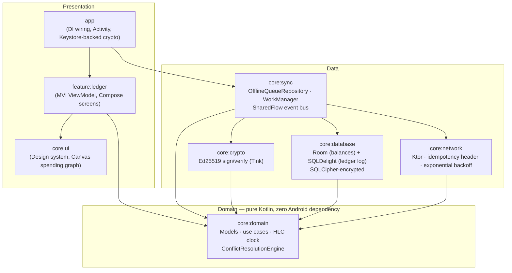

# Ledger Engine

**An offline-resilient, cryptographically-verified banking ledger for Android — zero data loss when the network disappears.**

This is a from-scratch, multi-module Android application demonstrating a
production-grade approach to a problem every fintech app eventually has to
solve: how do you let a user record a transaction with total confidence,
*before* you know whether the network is even there to accept it?

The answer here is a local-first ledger with Ed25519-signed, append-only
transactions, a Hybrid Logical Clock for deterministic offline ordering, and
a reactive conflict-resolution engine that reconciles the device and the
server without ever silently dropping or double-counting money.

## Why this architecture

A banking ledger has one non-negotiable property: **every transaction is
accounted for, exactly once, forever.** Everything below is in service of
that:

- **Local-first, not local-cache.** A transaction is durable the instant it
  hits the device's encrypted database — the UI never blocks on a network
  round-trip, and a submit can never be "lost" because connectivity dropped
  mid-request.
- **Every transaction is signed on-device** with Ed25519 before it leaves
  local storage. The backend (and other devices, via the conflict-resolution
  engine) verify the signature before trusting anything — a compromised
  network or a malicious relay cannot forge or tamper with a transaction.
- **Causal ordering survives being offline.** Two devices offline at the same
  physical millisecond still produce a strict, deterministic order, so
  reconciliation is never a coin flip.
- **Idempotency by construction.** Every transaction carries a client-generated
  idempotency key from the moment it's created, so retrying a dropped sync
  request can never double-spend.

## Architecture

Clean Architecture across eight Gradle modules, each with a single, narrow
responsibility:



**`core:domain` depends on nothing.** Every other module depends inward on
it, never sideways on each other — `core:crypto` doesn't know `core:database`
exists, `core:network` doesn't know `core:sync` exists. That's what makes
`ConflictResolutionEngine`, the HLC clock, and the money math in `core:crypto`
testable with plain JUnit, no emulator, no mocks-of-mocks.

### The two-layer local store

| Layer | Technology | Role |
|---|---|---|
| Event log | **SQLDelight** | Append-only source of truth for every transaction ever created on-device. Compiled, typed SQL with none of Room's reflection overhead on the hot write path. |
| Balance projection | **Room** | Materialized `accounts` table, updated atomically alongside every event-log write. O(1) balance reads for the UI — never an aggregate scan over the ledger. |

Both are opened through the same `net.zetetic:android-database-sqlcipher`
`SupportFactory`, so both databases are encrypted at rest with a passphrase
that itself never leaves the Android Keystore in cleartext
(`DatabasePassphraseProvider`, wrapped via `EncryptedSharedPreferences`).

### Cryptographic signing

`core:crypto` defines the signing contract (`SigningKeyProvider`,
`VerificationKeyProvider`) as plain interfaces with **zero Android
dependency**, so `TransactionSigner`/`TransactionVerifier` — real Ed25519
sign/verify via Google Tink — are unit-testable on the JVM. The production
implementation lives in `app`:
[`AndroidKeystoreSigningKeyProvider`](app/src/main/kotlin/com/ledgerengine/app/crypto/AndroidKeystoreSigningKeyProvider.kt)
generates the private key inside the Android Keystore (StrongBox-backed
where the chipset supports it) via Tink's `AndroidKeysetManager` — the raw
key material is never directly readable by the app process.

### Conflict resolution

[`ConflictResolutionEngine`](core/domain/src/main/kotlin/com/ledgerengine/domain/conflict/ConflictResolutionEngine.kt)
is the reactive heart of offline resilience. Every event pushed from the
backend's WebSocket stream (`RemoteEventReconciler`) is checked against the
local ledger by idempotency key, verified cryptographically, and ordered by
[`HlcTimestamp`](core/domain/src/main/kotlin/com/ledgerengine/domain/clock/HybridLogicalClock.kt)
to resolve exactly one of: a new remote transaction, a confirmation of a
local one, a causally-superseded local transaction, or a hard integrity
violation (never silently swallowed).

### UI performance

`feature:ledger` follows MVI (`LedgerIntent` → `LedgerViewModel` →
`LedgerUiState`) with `@Immutable`-annotated state and `ImmutableList`
collections, so Compose can skip recomposing subtrees whose slice of state
didn't change. The spending chart
([`SpendingGraph`](core/ui/src/main/kotlin/com/ledgerengine/ui/chart/SpendingGraph.kt))
reads its reveal animation's `Animatable` value *inside the `Canvas`
draw-phase lambda*, so the 600ms entrance animation re-runs only drawing —
never composition or layout — for a smooth 120Hz redraw on capable displays.

### Networking

`core:network` wraps Ktor's CIO engine with:
- A custom **`IdempotencyKeyPlugin`** client plugin that injects the
  `Idempotency-Key` header on every mutating request.
- **`HttpRequestRetry`** configured for exponential backoff on transient
  failures, layered underneath **WorkManager**'s own coarser backoff/retry
  for entire sync batches when there's no connectivity at all.
- An explicit `NetworkResult` success/API-error/connectivity-error channel,
  so transport failures never leak as uncaught exceptions into the sync layer.

## Module map

```
app/               Application, MainActivity, Hilt DI wiring, Keystore-backed crypto
core/domain/        Pure Kotlin: models, use cases, HLC clock, conflict resolution
core/crypto/         Ed25519 sign/verify (Tink) — pure JVM, Android-agnostic
core/database/       Room (encrypted balances) + SQLDelight (encrypted ledger log)
core/network/        Ktor client, idempotency header, exponential backoff
core/sync/           WorkManager offline queue, repository, SharedFlow event bus
core/ui/             Design system, Canvas-based spending graph
feature/ledger/      MVI ViewModel + Compose screens
```

## Testing

Every module below the Android platform boundary is covered by real,
executable JUnit tests — no `TODO()`, no `@Ignore`:

- `core:domain` — HLC monotonicity/merge semantics, exact-decimal `Money`
  arithmetic, and every branch of `ConflictResolutionEngine`.
- `core:crypto` — round-trip Ed25519 sign→verify, tamper detection, and
  cross-key rejection, against the real Tink primitives (not a mock).
- `core:network` — idempotency header injection, exponential-backoff retry
  behavior, and connectivity-error handling, against a Ktor `MockEngine`.
- `core:sync`, `feature:ledger` — repository and MVI ViewModel behavior via
  MockK + `kotlinx-coroutines-test`.

```bash
./gradlew test          # all unit tests
./gradlew :core:domain:test :core:crypto:test :core:network:test  # pure-JVM subset
```

## Building

Requires the Android SDK (compileSdk 35) and JDK 17+. From the repo root:

```bash
./gradlew :app:assembleDebug
```

CI (`.github/workflows/ci.yml`) runs the full unit test suite, Android Lint,
and a debug assembly on every push and pull request.

## Tech stack

Kotlin · Jetpack Compose (Material 3) · Coroutines & Flow · Room · SQLDelight ·
SQLCipher · Google Tink (Ed25519) · Ktor · WorkManager · Hilt · MockK · Turbine
